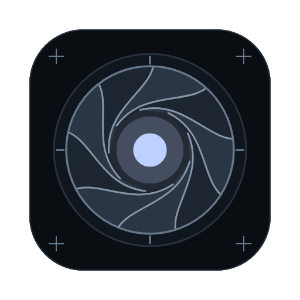

# Iris: a credential broker for Claude Code

Local Claude Code gets your credentials (kubectl, gcloud, aws, git, docker, curl to APIs) only after you approve a popup that says what it wants, and the approval expires.

```
Claude Code (sandboxed bash)                          your Mac, outside the sandbox
  kubectl / aws / gcloud / git / docker
    └─ iris-helper  ── broker.sock ──────────────►  irisd (launchd agent)
                                                     ├─ grant table (TTL, in memory)
                                                     ├─ no grant → Iris.app popup / Touch ID
  curl https://api…  ── httpProxyPort ───────────►  ├─ egress proxy: injects auth header
                                                     ├─ mints from 1Password / Keychain / command
  PreToolUse hook ── "kubectl delete pod x" ──────►  └─ audit.jsonl
                                                  ◄── control.sock ── Iris.app menu bar, `iris` CLI
```

The sandbox can't read `~/.kube`, `~/.aws`, `~/.config/gcloud`, `~/.ssh`, and so on, so the only way to use a credential is to ask the broker. The broker can't be approved from inside the sandbox: `control.sock` isn't in the sandbox socket allowlist, and it also refuses any process descended from Claude Code.

## Pieces

| | What | Runs |
|---|---|---|
| `iris` | CLI: `install` configures Claude Code, `provision` creates Claude-only identities, `daemon` is the broker, plus grants/revoke/audit/doctor | your terminal, launchd |
| `iris-helper` | tiny credential-helper binary, holds no secrets | inside the sandbox |
| `Iris.app` | SwiftUI menu bar app: approval popups, Touch ID, active grants, revoke-all, recent activity, one-click setup | your Mac |

 

The popup and the menu bar icon are an iris shutter. In the menu bar it's closed when nothing is granted, open while Claude holds a grant, and struck through when the broker isn't reachable. In the popup it stays shut until you approve (after Touch ID, if enabled), then spirals open; Deny makes it clunk shut. It's drawn in code (`IrisShutter.swift`), with no image assets.

## Install

From a release (built by CI): unzip `Iris-x.y.z.zip`, move `Iris.app` to `/Applications`, open it, then click **Set up Claude Code** in the menu. Or:

```bash
make install          # CLI only → ~/.local/bin/{iris,iris-helper}
```

```bash
iris install          # merges ~/.claude/settings.json, generates Claude-only configs, starts launchd agent
```

```bash
make app              # macOS: dist/Iris.app (needs Xcode CLT + Go)
```

### Getting `iris` on your PATH

The app bundles the CLI at `/Applications/Iris.app/Contents/Resources/bin/iris`. Link it once, from the app menu (**Install `iris` command**) or from a terminal:

```bash
/Applications/Iris.app/Contents/Resources/bin/iris link --add-to-path
```

This symlinks `iris` into the first writable dir already on your PATH (`~/.local/bin`, `/opt/homebrew/bin` or `/usr/local/bin`). If none qualifies, it uses `~/.local/bin` and, with `--add-to-path`, adds that dir to your `~/.zshrc` (or `.bash_profile` / fish config) once. Open a new terminal afterwards. `iris-helper` stays inside the app and is referenced by absolute path, so it doesn't need to be on PATH. If you move the app, re-run `iris link` and `iris install`.

### Several Claude aliases (`CLAUDE_CONFIG_DIR`)

If you run e.g. `alias claude-work='CLAUDE_CONFIG_DIR=~/.claude-work claude'`, each config dir has its own `settings.json` and needs its own Iris setup.

```bash
iris claude detect            # finds ~/.claude*, CLAUDE_CONFIG_DIR=… in ~/.zshrc etc., $CLAUDE_CONFIG_DIR
```

```bash
iris install --detect         # configure all of them (the app's "Set up Claude Code" does this)
```

```bash
iris claude add ~/.claude-oss
```

```bash
iris claude remove ~/.claude-oss    # takes Iris back out of that dir's settings
```

The list is stored as `claude.configDirs` in the Iris config. Each dir gets a **profile** named after it (`~/.claude-work` becomes `claude-work`):

- The popup says "Claude (claude-work) wants a credential", and the audit log and grants list show the profile.
- Grants are per profile: approving `kubectl` for `claude-work` doesn't cover `claude-personal`. "Until session end" grants are revoked when that profile's session ends.
- Every dir denies Claude edits to *every* configured `settings.json`, so one profile can't loosen another.
- `iris doctor` checks each dir and warns about any Claude config dir it finds that isn't protected.

The profile label comes from inside the sandbox (`IRIS_PROFILE`), so it keeps grants apart and makes popups readable, but it isn't a security boundary. The popup is the boundary.

`iris install` is idempotent and reversible: it writes a backup, records every entry it adds in `~/.config/iris/installed.json`, and `iris uninstall` removes exactly those entries. Re-run it after every config change; `iris provision` does that for you.

### What `iris install` changes in Claude Code

- `sandbox.enabled`, `failIfUnavailable: true`, `allowUnsandboxedCommands: false` (no escape hatch)
- `sandbox.credentials`: denies the credential files listed above, plus about 30 secret env vars (`AWS_*`, `GITHUB_TOKEN`, …)
- `permissions.deny`: `Read(~/.kube/**)` and friends, because Claude's Read tool is **not** sandboxed. Also `Edit(~/.config/iris/**)` and `Edit(~/.claude/settings.json)`, so Claude can't rewrite its own cage.
- `sandbox.network.allowUnixSockets: [~/.local/state/iris/broker.sock]`. This is the answer to the brief's open question 1.
- `env`: points `KUBECONFIG`, `AWS_CONFIG_FILE`, `CLOUDSDK_CONFIG`, `GIT_CONFIG_GLOBAL`, and `DOCKER_CONFIG` at generated Claude-only files in `~/.local/share/iris/claude/`. Your own terminal never sees these, so it's unaffected (open question 3).
- hooks: `PreToolUse` sends the pending command to the popup, `SessionStart` puts the shim dir on `PATH`, `SessionEnd` revokes "until session end" grants
- with the proxy enabled: `httpProxyPort` and a CA bundle (`SSL_CERT_FILE`, `NODE_EXTRA_CA_CERTS`, …)

## Your own credentials, approved per use (passthrough)

This is the default. Claude Code normally runs as **you**: anything it runs can use your kube contexts, AWS profiles, gcloud login and git credentials, and you don't see it happen. With passthrough on, the sandbox still hides all of those, and every use goes through the iris dialog first:

```bash
iris passthrough on            # kube, aws, gcp, git, docker (the starter config has this already)
```

```bash
iris passthrough on kube,aws   # or just some tools
```

```bash
iris passthrough status
```

- Claude sees the same kube contexts and AWS profiles you have, under the same names. Each one points at `iris-helper` instead of a real credential.
- When something needs a credential (`kubectl get pods`, `aws s3 ls`, `git push`), the popup shows the context or profile, the command, the process, and an orange **Your credentials** tag. Deny and nothing runs. Allow and the broker resolves **your** credential on the host:

| Tool | How your credential is resolved after you allow |
|---|---|
| kube | your kubeconfig's user for that context: exec plugin (gke-gcloud-auth-plugin, aws eks, kubelogin…) run on the host, or token / client cert |
| aws | `aws configure export-credentials` (SSO, assume-role). Long-term keys are swapped for a 1h `get-session-token`, and iris refuses rather than hand out the long-term key |
| gcp | `gcloud auth print-access-token` for your active account (re-fetched every 10 min) |
| git | `git credential fill` with your helpers (osxkeychain, gh, manager), never prompting. SSH remotes are rewritten to HTTPS |
| docker | your `credHelpers` / `credsStore` / `auths` |

- Nothing runs on your side before you click Allow: no SSO browser tabs, no keychain prompts, no exec plugins.
- The context or profile name comes from inside the sandbox, so it's validated (no leading `-`, no spaces or newlines) and passed as `--context=` / `--profile=`, so it can't smuggle flags.
- The audit log marks every passthrough issue `your credentials`. If the secret itself doesn't expire (static kube token, client cert, PAT), it also notes `long-lived`, because revoking the grant then stops iris handing it out but not a copy Claude already has.
- After you add kube contexts or AWS profiles, re-run `iris install` so Claude sees them.
- Mixing modes works: an identity from `iris provision` takes precedence for its target, and everything else passes through. Use `iris passthrough off kube` to only allow the identities you provisioned for kube.

## Claude-only identities: `iris provision`

Run these from **your** terminal. Each one creates a narrow identity with your credentials and adds it to the config. The broker then mints short-lived credentials for that identity, never for your personal one.

```bash
iris provision kube --context staging-admin --role view            # SA iris/claude-view + ClusterRoleBinding; tokens via `kubectl create token`
```

```bash
iris provision kube --context prod-admin --name prod --role edit --only-namespace app --ttl 15m
```

```bash
iris provision gcp --project my-proj --roles roles/viewer,roles/logging.viewer   # SA + roles + TokenCreator for you; tokens by impersonation
```

```bash
iris provision aws --profile admin --name claude-read --region eu-west-1         # role iris-claude-read (ReadOnlyAccess) trusted only by you; sts assume-role
```

```bash
iris provision github --owner acme --permissions contents:write,pull_requests:write --http   # opens a pre-filled fine-grained PAT page, stores token in Keychain
```

```bash
iris provision secret --tool http --target api.openai.com            # any API key → Keychain, injected by the proxy
```

Every provisioner supports `--dry-run`, which prints the exact `kubectl`/`gcloud`/`aws` commands and changes nothing.

## Using it

Inside Claude: `kubectl get pods` opens a popup with **Deny · Once · 15 min · 1 h · Until session end**. Return picks the shortest option, Escape denies, and no answer within 60 s denies.

```bash
iris status           # daemon, UI, identities, grants
```

```bash
iris revoke --all
```

```bash
iris audit -n 20
```

```bash
iris doctor           # host-side checks
```

Ask Claude to run `iris selftest`. It runs the acceptance checks from inside the sandbox: credential files unreadable, no secret env vars, broker reachable, control socket unreachable, Keychain not visible.

## Config (`~/.config/iris/config.yaml`)

```yaml
approval: {timeout: 60s, options: [once, 15m, 1h, session], sessionMax: 8h, touchID: true}
proxy: {enabled: true, listen: 127.0.0.1:18899, allowedHosts: ["*.github.com", "registry.npmjs.org"]}
identities:
  - tool: kube            # kube | aws | gcp | git | docker | http
    target: staging       # context | profile | project | git host | registry | API host
    scope: read           # label in the popup; real scope = the identity's permissions
    maxTTL: 1h            # caps both the credential and the longest button offered
    source:               # exactly one of:
      command: [kubectl, --context, staging-admin, -n, iris, create, token, claude-view, --duration, 1h]
      # op: op://Private/item/field
      # keychain: {service: iris, account: github.com}
      # env: NAME   /   file: ~/path
```

Source output is auto-detected: a raw token, a kube `ExecCredential`, AWS `credential_process` JSON, `sts assume-role` JSON, or `{"token": …, "expires_at": …}`. The credential handed out expires at whichever comes first, the source expiry or the grant expiry.

| Tool | Hook used | Notes |
|---|---|---|
| kubectl | kubeconfig `users[].user.exec` | kubectl caches until `expirationTimestamp` (= grant expiry) |
| aws | `credential_process` | SDKs refresh after `Expiration` |
| gcloud / bq / gsutil | PATH shim → `CLOUDSDK_AUTH_ACCESS_TOKEN_FILE` (temp file, deleted on exit) | gcloud has no exec hook. Google client libraries using ADC are **not** covered |
| git | credential helper (`helper =` reset + iris), SSH remotes rewritten to HTTPS | `password_expiry_utc` stops git caching past expiry |
| docker | `credHelpers` → `docker-credential-iris` | |
| curl / HTTP | proxy: TLS-terminated with the Iris CA, header replaced | `http://host` is upgraded to HTTPS upstream, so tools that can't trust the CA still work (open question 2) |

## Security model and known gaps

Same threat model as the brief: a prompt injection or a confused agent. A compromised host is out of scope, and so is you approving something bad. Honest list of gaps:

1. **Keychain visibility.** Items written by `security add-generic-password` can be read by `/usr/bin/security`. If Claude's Seatbelt profile allows the `securityd` mach lookup, sandboxed Bash could read them. `iris selftest` checks for this. If it fails, use `op://` sources: the 1Password CLI needs the app's socket, which the sandbox can't reach. A `Bash(security find-generic-password:*)` deny rule is installed, but it's a speed bump, not a wall.
2. **Approved credentials do enter the sandbox** for kube, aws, gcp, git, and docker. That's inherent to helper protocols. Only the proxy path keeps tokens out. Mitigations: short TTLs and narrow identities, which is why `provision` exists.
3. **A static secret outlives its grant.** A GitHub PAT handed out under a 15-minute grant is still valid at GitHub afterwards. Revoking stops Iris from handing it out again, not Claude from reusing a copy. Prefer minted sources (`kubectl create token`, impersonation, `assume-role`).
4. **The popup context is advisory.** Anything in the sandbox can send a fake "pending command". The panel says so, and the scope comes from the identity, never from parsing the command.
5. **The proxy bypasses Claude's domain allowlist** (setting `httpProxyPort` does that). Fill `proxy.allowedHosts`.
6. Grants live in memory: restarting the daemon revokes everything, by design.

## Auto-update

Iris.app updates itself with [Sparkle](https://sparkle-project.org). Every 6 hours it checks `appcast.xml` on the latest GitHub release, then downloads and installs the update. The broker is restarted on the new version automatically. "Install updates automatically" and "Check for updates" are in the menu.

Each update must pass two checks: Apple's notarization, and an Ed25519 signature made with a key that lives only in the `SPARKLE_ED_PRIVATE_KEY` GitHub secret. Someone who could replace a file on the GitHub release still couldn't ship an update.

One-time setup, on your Mac, with an `iris` from a build that includes this feature:

```bash
iris dev sparkle-keygen
```

The private key goes to your clipboard. Add it as the repository secret `SPARKLE_ED_PRIVATE_KEY` and keep a copy in your password manager: losing it means installed apps can't verify updates any more. Builds without the secret have the updater switched off. Releases made with the secret publish `appcast.xml` next to the zip.

## Development

```bash
make test
```

```bash
IRIS_HOME=/tmp/ih iris daemon     # isolated home for experiments
```

CI (`.github/workflows/build.yml`): Go vet and race tests on Linux, a darwin cross-compile, then on macOS darwin tests, a universal `Iris.app` (Swift + lipo'd Go), an ad-hoc signature, a CLI smoke test, and the zip uploaded as an artifact. Tags `v*` publish a GitHub release. With the signing secrets set, CI signs with your Developer ID, notarizes and staples: see [docs/notarization.md](docs/notarization.md).
